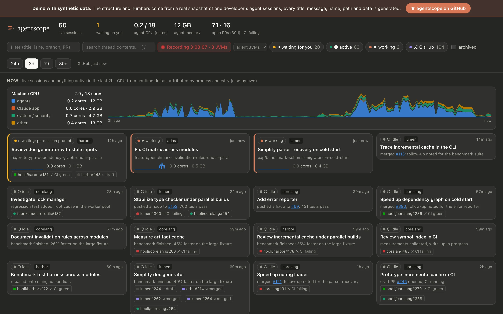
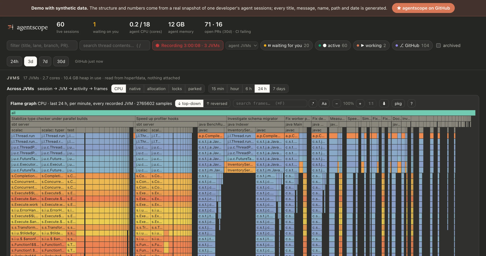
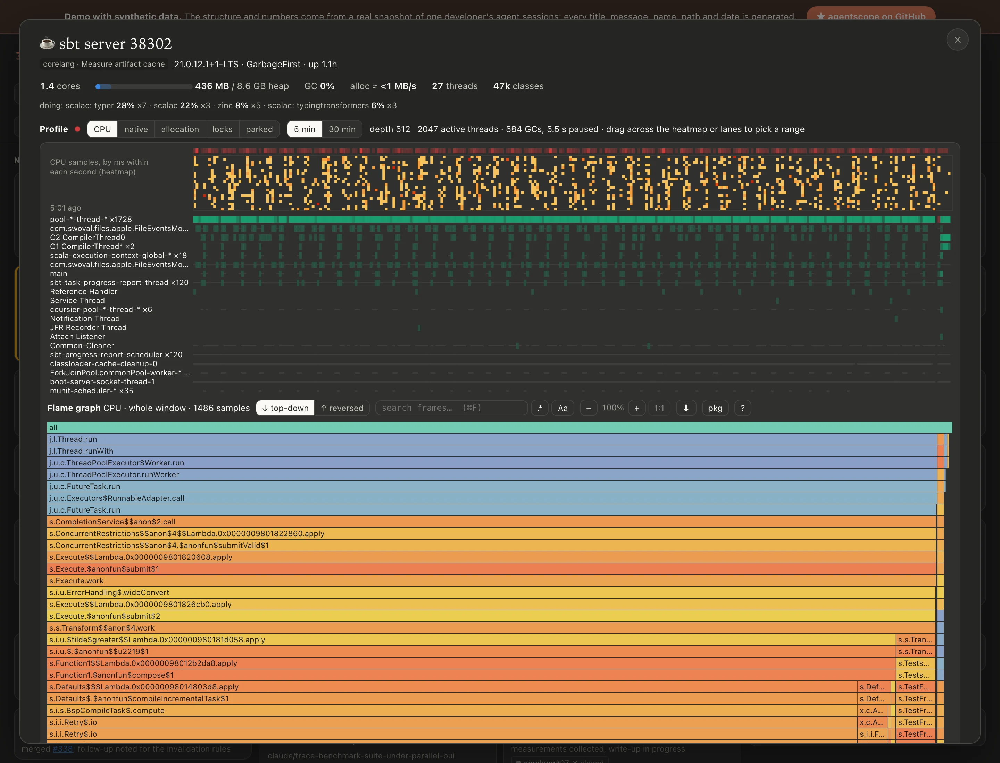
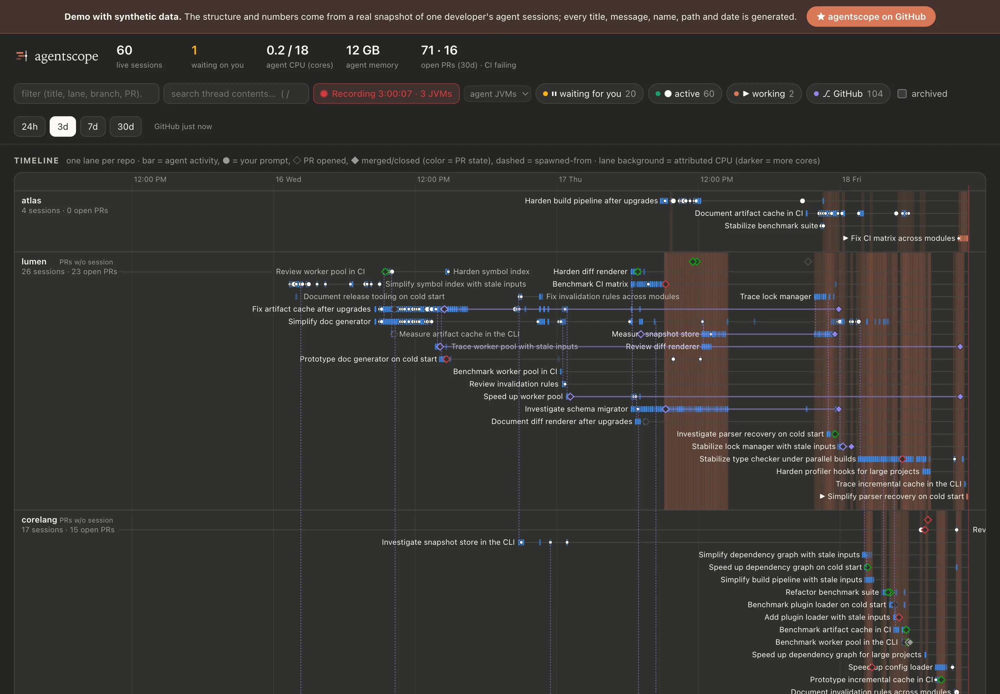
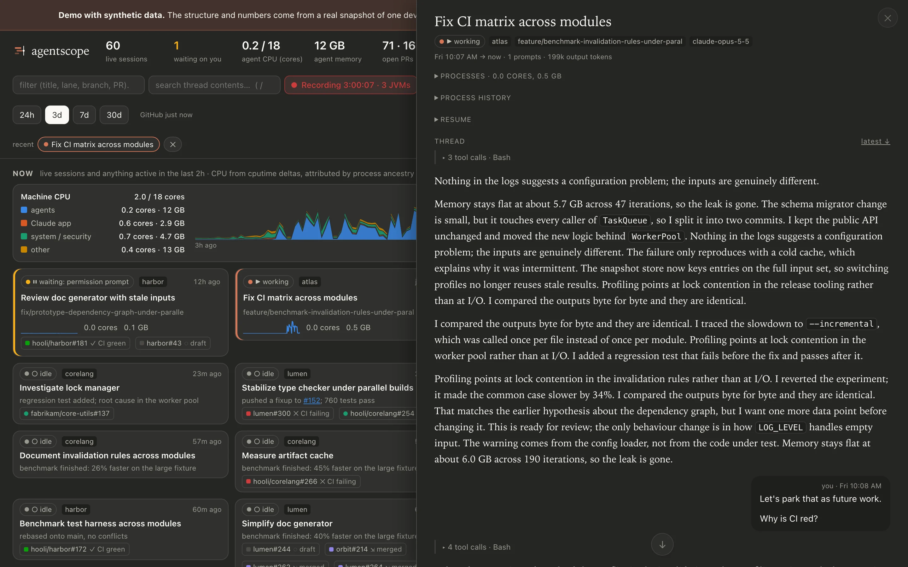
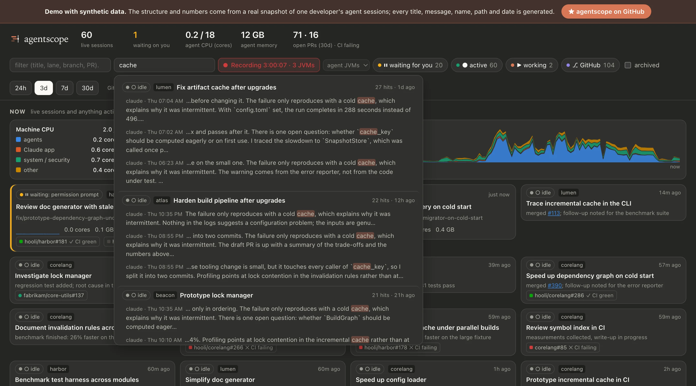
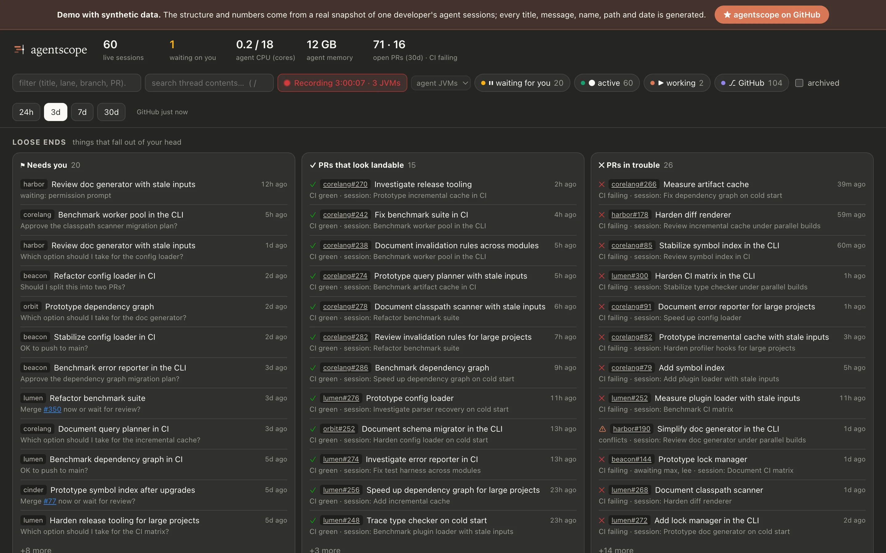
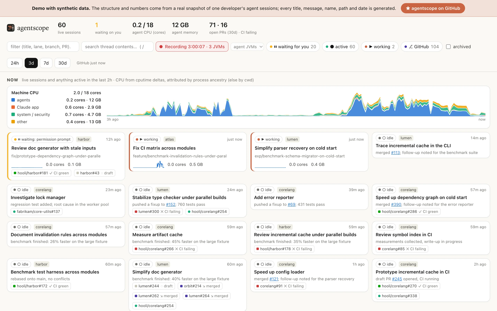

<h1> agentscope</h1>

**One local page for keeping track of many concurrent Claude Code agent sessions: what each one is doing right now, what it has done this week, which PRs it produced, how much of your machine it is using (and, for the JVM builds it starts, where that CPU went), and what it left waiting on you.**

<p>
  <a href="https://retronym.github.io/agentscope/"><b>▶&nbsp;Try the live demo</b></a>
  &nbsp;·&nbsp; a real snapshot of ~140 sessions with every title, message, name, path and date replaced by synthetic ones; its JVM profiles are recordings of public builds
</p>

[](https://retronym.github.io/agentscope/)

## Why

Running a dozen or more agent sessions across several repositories, the Claude app's session list stops being enough. Four things get lost:

- **Right now.** Which sessions are working, which are blocked on a permission prompt or a question, and which one is quietly pinning six cores with a forked build.
- **Over time.** What happened in each repo this week, which session produced which PR, which session spawned which.
- **Where the CPU went.** Agents start builds: sbt servers, Gradle daemons, forked tests. When the machine is pinned or a session is slow, you want to know what those JVMs were doing, not just that they were busy.
- **Loose ends.** Questions an agent asked that you never answered, follow-ups it proposed, PRs that went quiet when their session did. These are exactly the things that fall out of your head.

agentscope reads what Claude Code already records on your machine, joins it with your PRs on GitHub and the live process table, and puts it on one page that refreshes every few seconds.

## What you get

### Now

Live sessions first: waiting on you, then working, then recently active. Each card shows the agent's last status line, attributed CPU and memory with a sparkline, the heavy processes it is running, and its PRs with CI and review state. A machine strip splits total CPU into agents, the Claude app, system/security software and everything else; hover it to see which sessions were busiest at any moment.

Cards stay put: they only reorder when a session's state or CPU tier changes materially, and moves are animated. Status chips (*waiting for you*, *active*, *working*, *GitHub*) filter every view.

### JVMs: a profiler for every build your agents start



Most of the heavy lifting on a card is a JVM: an sbt server, Bloop, a Gradle daemon, a forked test run. A process list can tell you *which* one is pinning your cores, but not *why*: compiling, testing, resolving dependencies, or thrashing in GC. Nor can the agent waiting on that build. Press **Record** in the header and agentscope profiles every agent JVM (or every JVM of yours) continuously, picking each one up as it starts, so the answer is already there when you ask.

**Across JVMs** is one flame graph over all of them, for any range from the last 15 minutes to the last 7 days, rooted at session, then kind of JVM, then activity, then frames. It answers questions a one-process profiler can't: which sessions' builds cost the most this week and doing what (scalac's typer, zinc, tests, dependency resolution); how much of yesterday went into one compiler phase across every sbt server; what a forked test JVM that exited hours ago was busy with. Every minute of every recording is kept losslessly for a week (deep compiler stacks cost a couple of MB of disk per recorded minute; see [the design](docs/jvm-profiler.md#8-storage-raw-in-jfr-aggregates-in-sqlite)). It's continuous profiling in the style of Pyroscope or Parca, with nothing to deploy and every sample attributed to the session that started the build.

**Activity** shows the same thing live, the way Gradle's console shows its workers: for every recorded JVM, grouped by session, each busy thread with what it's doing now and the frame that shows it, then one lane per thread (threads of a pool share one) over the last 5 or 30 minutes, coloured by activity. Activities come from rules that name compiler phases, test frameworks, dependency resolution and build tools, and each JVM's row and its session's card carry a line like *scalac: typer 62% · zinc 20%*. Drag across the lanes to pick the range for Across JVMs; click a lane to open that thread's profile.



**A JVM's full view** (⤢) has a sub-second CPU heatmap, one lane per thread or thread pool coloured by what it's doing (on CPU, in native code, parked, blocked on a lock), and a flame graph of CPU, native, allocation, lock or park time. Drag across the heatmap or lanes to pick a range; click a thread's name to see only that thread.

Every flame graph has the same controls. Click a frame to zoom in; Ctrl/⌘+scroll, pinch or Shift+drag zoom at the cursor, and detail appears as you zoom. Search takes a regex, shows what share matched, and Enter keeps it as a highlight. Filters stack and can each be removed: keep or hide the stacks through a pattern, hide one stack, merge a function away (lambda frames, recursion), or focus on a function (every call to it, merged). Frame types (interpreted, C1, C2/JIT, inlined, native, C++, kernel) show as a thin coloured strip along the bottom of each frame, split by how much of it ran as each, with the shares in the tooltip; the legend highlights the frames that are mostly one type, and the **types** button (or J) turns it off. Right-click a frame for all of these, or press ? for the keys.

**What it costs**: recordings are JFR with agentscope's own low-overhead settings, started with `jcmd`, so nothing is left loaded in the JVM. On a javac workload, CPU per compile was the same with and without the recording, within noise (`mise run bench-overhead`). Stacks are 512 frames deep by default, since JFR's default of 64 cuts off a compiler's recursion. Recordings stop when you press Stop or quit agentscope.

Without recording, the JVMs table is a `top` for every JVM, read from the counters HotSpot already publishes for `jstat` (`hsperfdata`), so nothing attaches: CPU, heap against committed and max, GC share, allocation rate, threads, classes (live, loaded and unloaded), JIT compiles and compiler time, and the last three hours per minute. **JVMs in trouble** in Loose ends lists any spending a fifth of their time in GC, staying near their max heap after collections, or running full GCs. An expanded row can take **snapshots**: two thread dumps a second apart (each thread with the CPU it used in between, deadlocks called out), heap, class histogram, code cache and native memory. With [async-profiler](https://github.com/async-profiler/async-profiler) installed, a JVM's full view can also take a **capture**: what async-profiler sees that JFR doesn't (native and JIT/GC frames, wall clock across every thread, live objects, native memory and locks), shown like a recording, with heatmap, thread lanes and GC pauses, filling in as it runs. The JVM records with JFR for the capture's window, which supplies thread CPU load, GC and anything async-profiler wasn't asked for. Captures are kept 30 days, diffable against each other, and downloadable as `.jfr` for JMC. Snapshots, recording and captures go through a small Java helper, built once with `mise run build-profiler`.

The design, what was learned building it, and what's next are in [docs/jvm-profiler.md](docs/jvm-profiler.md).

### Timeline



One lane per repository, with forks and upstream sharing a lane. Each session is a bar shaded by agent activity; dots mark your own prompts, so you can see where your attention went. ◇ and ◆ mark PRs opened and merged, on the row of the session that owns them. Dashed lines join a session to the one that spawned it. A lane's background darkens with the CPU attributed to it; hover to see which processes were behind it.

### Session panel



Click any session for its status, PRs, related sessions, process history, and the transcript as a thread: your turns as bubbles, agent replies rendered from markdown, runs of tool calls collapsed. Every PR and issue reference is a link, including a bare `#123`, which resolves against the session's repository. **↗ Claude** opens the session in the desktop app. Swipe right or press Esc to close; a *recent* strip keeps the last dozen sessions you opened.

### Search



Press `/` to search every prompt and agent message across all sessions (SQLite FTS5: stemmed, all terms required, `"quoted phrases"`). Hits are grouped by session with highlighted snippets; clicking one opens the thread scrolled to that message.

### Keyboard

The keys follow GitHub's; press `?` for the list. ⌘K jumps to any session, JVM or section by name. `g n` / `g j` / `g t` / `g e` jump to Now, JVMs, Timeline and Loose ends; `j` / `k` walk the session cards, JVMs and loose ends, `o` or Enter opens one, and with a session open `j` / `k` step the panel through the list. On a JVM, `o` opens the full view, `x` expands the row in place and `r` starts or stops recording. `c` continues the session in the Claude app, `z` folds the section, `f` filters, `1`–`4` pick the time range.

### Loose ends



- **Needs you:** sessions blocked on a prompt, or whose last turn ended with a question to you.
- **PRs that look landable** and **PRs in trouble** (failing CI, changes requested, conflicts).
- **Gone quiet with open PRs:** the session stopped, the PR didn't.
- **Ideas and offers left hanging:** proposals the agent made that you never started, and threads that ended on "should I…" or "follow-up".
- **Open PRs with no session**, and **unarchived sessions idle for days**.

It follows your system's light or dark theme:

 

## How it works

### Attributing load to sessions

CPU comes from cputime deltas between samples every 5 seconds, not from `ps`'s decaying `%cpu`. Each process is credited to a session by, in order:

1. **Ancestry:** it descends from the session's `claude` process (`~/.claude/sessions/<pid>.json` maps PIDs to sessions).
2. **Working directory:** it runs in the session's worktree or scratchpad (scratchpad paths embed the session id).
3. **Sticky:** it was credited earlier and has since daemonized, like an sbt server reparented to launchd.
4. **Mentioned:** it runs in an extra worktree that the session's own tool calls most recently referred to.

### Data sources

Everything is local and read-only except the GitHub query:

| Source | What it provides |
|---|---|
| Desktop app session metadata (`~/Library/Application Support/Claude/claude-code-sessions`) | titles, branches, archived flag, bound PRs, post-turn status summaries, spawn links, proposal outcomes |
| `~/.claude/sessions/*.json` (and every other config dir) | live PID → session, busy / idle / waiting |
| `~/.claude/projects/**/*.jsonl` (likewise) | transcripts: activity, prompts, messages, proposals, token counts |
| `ps`, `lsof` | the process tree, cputime, memory, working directories |
| `hsperfdata_<user>/<pid>` in the temp dir | every JVM's GC, heap, safepoint, thread, class and JIT counters, without attaching |
| `gh api graphql` | your open PRs and those closed in the last 45 days: CI, reviews, mergeability |

agentscope is a plain script. It makes no model calls, and nothing leaves your machine except the GitHub query and the two pinned markdown libraries the page loads from cdnjs.

### Storage

History lives in SQLite at `~/.cache/agentscope/agentscope.db`, one row per minute, from when the server first ran:

- `session_minute`, `bucket_minute`: CPU and memory per session and per machine group. Kept a year.
- `proc`, `proc_minute`: every process that used ≥ 0.5% CPU or ≥ 50 MB in a minute, with its command line, working directory, owning session and how it was attributed. Kept 30 days.
- `jvm`, `jvm_minute`: every JVM seen, with its session, version, collector and options, and its counters per minute. Kept 30 days.
- `capture`: async-profiler captures; the `.jfr` files (async-profiler's, and JFR's recording of the same window beside each) sit in `~/.cache/agentscope/captures`. Kept 30 days.
- `frame`, `node`, `tgroup`, `sample_blob`: recorded profiles, as constant pools (frames, stacks as a prefix tree, thread groups) and a compressed blob per JVM, minute and kind. Kept 7 days.
- `msg_fts`: the full-text index over prompts and agent messages.

Anything else is a SQL query away, for example CPU-hours per session today:

```
sqlite3 ~/.cache/agentscope/agentscope.db "select sid, round(sum(cpu)*0.6/3600,2) cpu_h from session_minute where t > strftime('%s','now','start of day') group by sid order by cpu_h desc limit 10"
```

## Getting started

Requirements: macOS, Python 3.10+ (standard library only) and an authenticated [`gh`](https://cli.github.com/). JVM snapshots also need JDK 21+ to build and run the helper: `mise run build-profiler`.

```
git clone https://github.com/retronym/agentscope && cd agentscope
python3 agentscope.py        # or: mise run serve
```

Then open http://localhost:8377. To try changes without touching your history, run a second copy on a scratch database: `python3 agentscope.py --port 8378 --db dist/dev.db`. Load history accumulates while the server runs, so leave it running: `mise run install-agent` makes it a launchd agent that starts at login and restarts if it dies, logging to `~/Library/Logs/agentscope.log` (`mise run uninstall-agent` removes it). It captures the installing shell's `PATH` and `JAVA_HOME`, so rerun it if `gh` or the JDK move.

**Several Claude accounts?** If you run `claude` with different `CLAUDE_CONFIG_DIR`s (e.g. `alias claude-work='env CLAUDE_CONFIG_DIR=$HOME/.claude-work claude'`), agentscope reads `~/.claude`, `$CLAUDE_CONFIG_DIR` and every `~/.claude-*` directory that holds sessions, and tags each session with the one it came from. To choose explicitly, pass `--claude-dir` once per directory, or set `AGENTSCOPE_CLAUDE_DIRS` (colon-separated). The startup line lists the directories in use.

Endpoint-security and MDM agents can be grouped under *system / security* with `AGENTSCOPE_SYSTEM_HINTS="SomeAV:mdm-agent"` (colon-separated command-line substrings).

The formats agentscope reads are Claude Code internals, not a public API, and may change between releases.

## Publishing a demo of your own

```
mise run demo          # writes dist/index.html: one self-contained file
mise run demo-serve    # export, then serve it on http://localhost:8380
mise run publish-demo  # force-push dist/index.html to the gh-pages branch
mise run screenshots   # regenerate docs/screenshots from the demo (headless Chromium)
```

The exporter keeps the *structure* of a real snapshot (timings, activity patterns, CPU and memory, statuses, PR states, session families, process trees) and replaces every piece of *text* with generated stand-ins of the same shape: titles, prompts, agent messages, branches, repo and owner names, PR titles, paths and command lines. A paragraph becomes a paragraph of similar length, a table a table, a list a list.

Before writing, it checks every string against a denylist built from the real snapshot (your GitHub login, home path, repo and owner names, session and PR titles, branch names) and refuses to write if anything survives. Timestamps are shifted back by a random 20–60 days plus some hours, drawn per export and never stored. GitHub records Pages deployment times publicly, though, so publishing right after exporting lets anyone estimate the offset.

## Future work

- **Talk to sessions from the page.** Reply to a session that is waiting on you, or nudge an idle one, without switching to the app. Leads:
  - Each live CLI session advertises a local socket (`messagingSocketPath`, `peerProtocol: 1` in `~/.claude/sessions/<pid>.json`). Sessions already use it to message each other, but it is undocumented, and a message sent that way arrives as a note from another agent rather than as the user.
  - The desktop app's `claude://code/new` deep link accepts a prompt (`q`) for a *new* session. There is no equivalent route for an existing one yet.
  - Remote Control sessions are reachable through an authenticated cloud channel, but that needs your claude.ai credentials, which a local dashboard shouldn't hold.

  Whichever channel, the server needs a safety gate before anything can type into a session that runs commands with your permissions. That means a random token printed at startup and required on every send (as Jupyter does), an `Origin` check against cross-site requests, binding to localhost only, and every sent message labelled as coming from agentscope.
- **Token usage.** Transcripts already record per-message usage: input, output, cache reads and writes, and model. Today only output tokens are summed. Next: tokens and cost per session, lane and day alongside CPU, cache hit rates, and "tokens per merged PR".
- **Review requests:** PRs where your review is requested, not just ones you authored.
- **Dismissing loose ends** you've dealt with, so the lists shrink.
- **Linux support:** `ps`/`lsof` differences and the app's session paths.

## License

[Apache 2.0](LICENSE)
